# Touch R1 Leader Arm 硬件

[← 首页](../README.md)　|　**简体中文**

提供 V3.1／V3.2 装配体 CAD 资源；当前物料清单及独立零件导出件仍基于 V3.1，七轴 URDF 基于 V3.2。

**目录：**

- [⚙️ 产品规格](#specifications)
- [📂 资源目录](#resources)
- [📐 装配模型](#assembly-model)
- [📋 物料清单](#bill-of-materials)
- [🔩 采购补充件](#purchase-parts)
- [🔎 待确认事项](#confirmation)
- [🛠️ 装配与校准](#assembly-and-calibration)
- [✅ 验证状态](#validation-status)

## 产品规格

| 规格 | Touch R1 Leader Arm |
| --- | --- |
| 硬件版本 | V3.1／V3.2，依据所提供装配体的文件名标注；BOM 仍基于 V3.1 |
| 产品类型 | 遥操作主臂 |
| 自由度 | 待确认 |
| 臂展与重量 | 待确认 |
| 电源与通信 | 待确认 |
| 执行器与编码器 | 待确认 |
| 关节运动范围 | 待确认 |

## 资源目录

| 目录／文件 | 内容 | 状态 |
| --- | --- | --- |
| [step/assembly/](step/assembly/) | 原始 V3.1／V3.2 装配体 STEP | 源文件字节保持不变；已检查 CAD 导入 |
| [step/components/](step/components/) | 用户提供的 RP8-U45H-M / C028 舵机 STEP | 用于 URDF 视觉模型，保留原文件内容 |
| [step/parts/](step/parts/) | 16 份独立零件或子装配 STEP | 已通过导出与重新导入检查 |
| [bom.json](bom.json) | BOM 数量、源编号、实例位置及几何检查结果 | 根据源装配树提取 |
| [printing/stl/](printing/stl/) | 可打印的零件网格 | 待补充 |
| [printing/3mf/](printing/3mf/) | 独立零件与整套打印项目 | 待补充 |
| [drawings/](drawings/) | 带尺寸工程图纸，PDF／DWG | 待补充 |
| [robot-description/](robot-description/) | V3.2 七轴 URDF、网格和交互预览 | 包含 J7 舵机与双 finger，排除两个限位块；实机参数待确认 |

## 装配模型

- [下载 V3.2 装配体 STEP](step/assembly/touch-r1-leader-arm-v3.2-1013.stp)：当前七轴 URDF 的源装配体，包含 J7 舵机和左右 finger。
- [下载 V3.1 装配体 STEP](step/assembly/touch-leader-arm-v3.1-1013.stp)：当前 BOM 和独立零件导出件的依据。

V3.2 原文件 `遥操臂V3.2_1013(1).stp` 仅规范保存名称，文件内容保持不变，共 115 个实体，包含 A000、B000。URDF 专用快照另外排除这两个限位块；[来源记录](robot-description/source/assembly-source.json) 保存原文件 SHA-256。

<a href="images/touch-r1-assembly.png">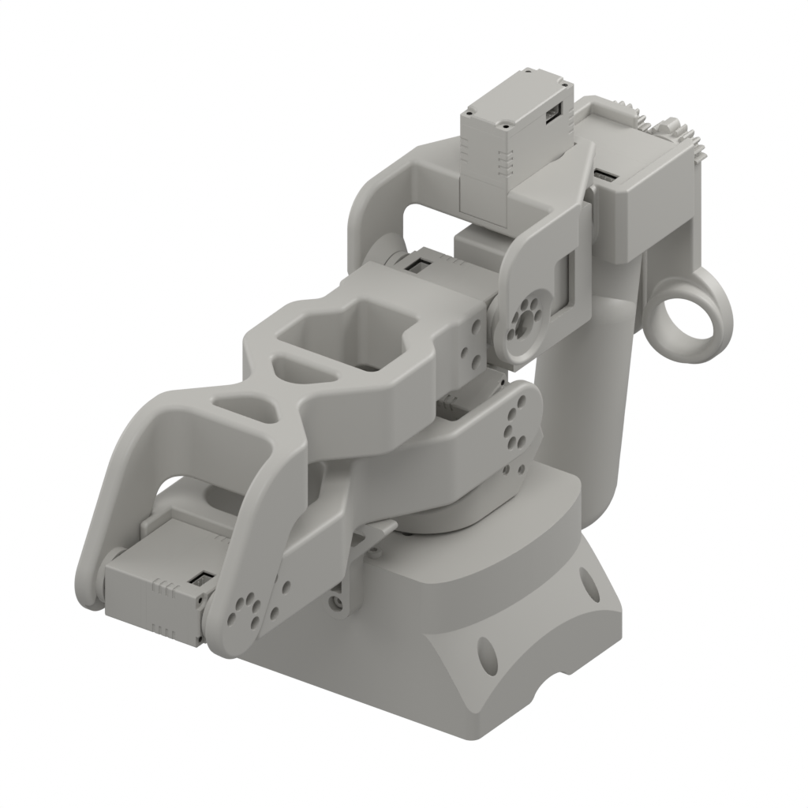</a>

所提供的文件 `遥操臂V3.1_1013.stp` 以 `touch-leader-arm-v3.1-1013.stp` 保存，内容未作修改。STEP 文件头记录的导出软件为 Creo Parametric，导出时间为 `2026-10-13T11:21:50`。版本标注来自源文件名。

独立 STEP 保留各组件自身的 CAD 坐标系；舵机导出件保留内部几何，作为完整子装配提供。这些文件为参考 CAD 导出件，尚未指定制造或打印工艺。

## 物料清单

下表列出一套所提供装配体中的 **12 种结构件与舵机子装配、16 个顶层实例**。数量来自 STEP 装配引用，按源 PRODUCT 标识合并重复件。装配体另有 5 个紧固件实例，属标准采购件，按采购规格列在[采购补充件](#purchase-parts)第 13、14 行；其源 PRODUCT 对应关系保留在 `bom.json`。两类舵机子装配各出现 3 次，其内部零件已包含在子装配中，不再重复列为采购项。展开全部子装配后为 **99 个叶级实例／实体**，不代表需要采购 99 件物料。装配实物另外还需要 6 种不在该模型中的标准五金件，同样见[采购补充件](#purchase-parts)。

结构件的资源标识与 STEP、图片文件名主体一致（不含扩展名）。全部简图均由源 STEP 几何渲染为 **1024 × 1024 白底图片**，点击可放大。统一灰色显示材质不代表实物材质、颜色或表面处理；各图独立缩放。

表内 CAD 包围尺寸为**零件本地坐标轴 X × Y × Z 的包围盒尺寸**，四舍五入到 0.01 mm，仅描述模型外包范围，不是工程尺寸、公差、螺纹尺寸或采购规格。紧固件按标准采购件列出，品名与规格按实物确认（2026-10-20），不据 CAD 或源名称推定螺纹。这份 CAD 提取 BOM 需要工程确认后才能用于采购；不会推测补入源模型中缺失的组件。

| 序号 | 品名 | 型号／规格 | 图片 | 描述 | 数量 |
| :---: | --- | --- | :---: | --- | :---: |
| 1 | 舵机子装配 | [touch-r1-servo-rp8-u45h-m-c028](step/parts/touch-r1-servo-rp8-u45h-m-c028.step) |  | 源名称：`RP8-U45H-M-C028_STEP_ASM` CAD 包围尺寸：40.10 × 45.80 × 20.21 mm。 源标签为 RP8-U45H-M-C028；含舵盘及内部 CAD 零件。交付配置待确认。 | 3 |
| 2 | 舵机子装配（型号待确认） | [touch-r1-servo-25-50kg-0001](step/parts/touch-r1-servo-25-50kg-0001.step) |  | 源名称：`_25-50KG-0001_ASM_ASM` CAD 包围尺寸：40.10 × 52.60 × 20.21 mm。 源标签为通用装配编号，不能据此确定采购型号；含舵盘及内部零件。 | 3 |
| 3 | 关节 1 结构件 | [touch-r1-joint-1](step/parts/touch-r1-joint-1.step) | <a href="images/touch-r1-joint-1.png">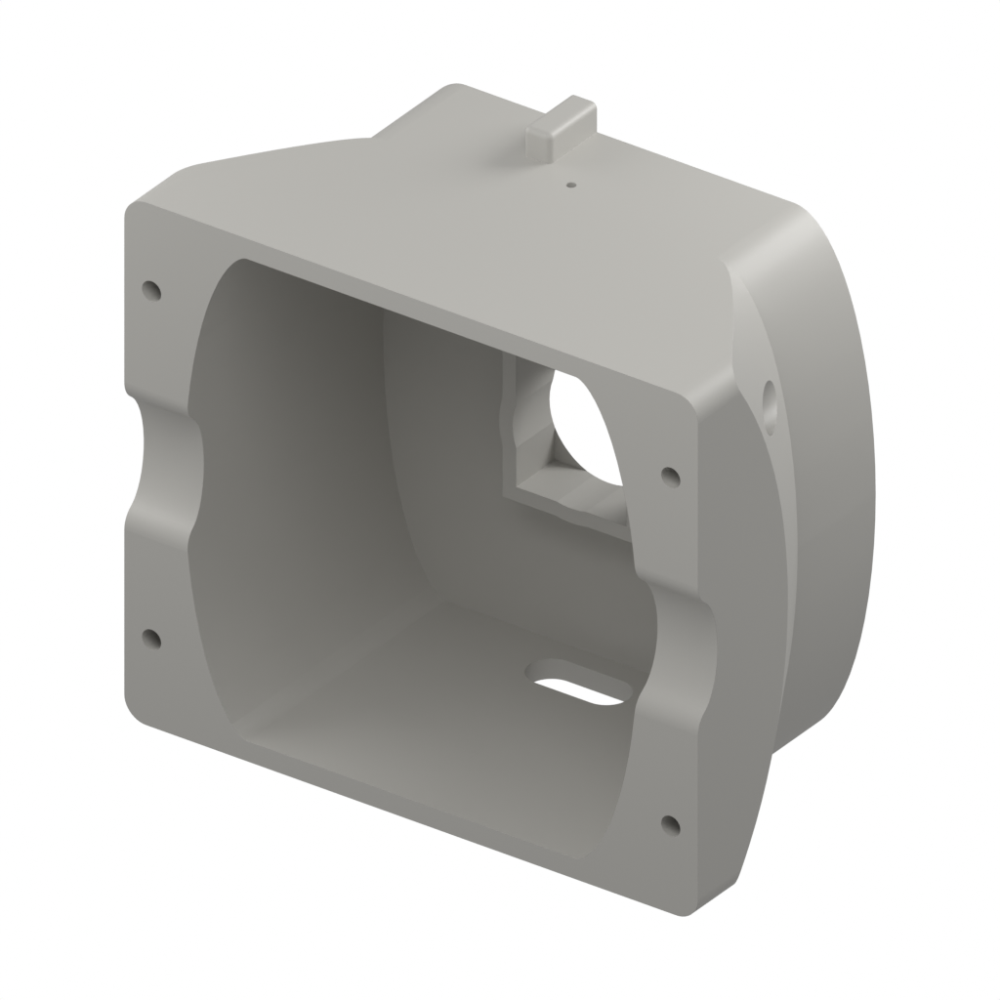</a> | 源名称：`关节1_NEW` CAD 包围尺寸：120.03 × 56.00 × 120.02 mm。 材质与制造工艺待确认。 | 1 |
| 4 | 关节 2 结构件 | [touch-r1-joint-2](step/parts/touch-r1-joint-2.step) | <a href="images/touch-r1-joint-2.png">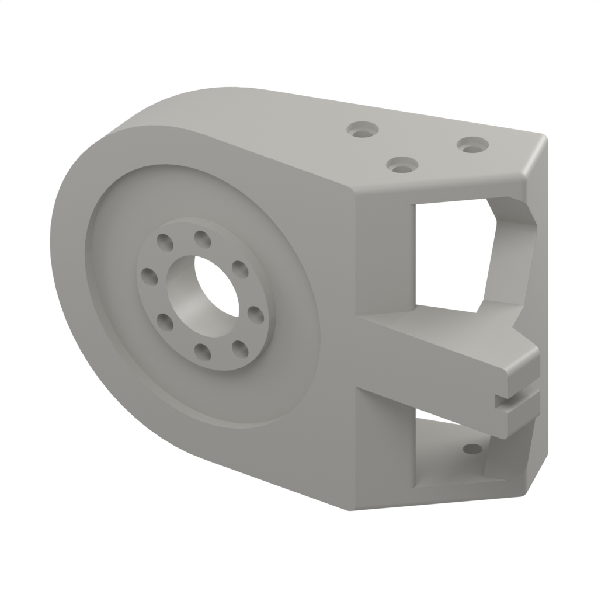</a> | 源名称：`关节2_新` CAD 包围尺寸：69.27 × 27.42 × 46.15 mm。 材质与制造工艺待确认。 | 1 |
| 5 | 关节 3 结构件 | [touch-r1-joint-3](step/parts/touch-r1-joint-3.step) | <a href="images/touch-r1-joint-3.png">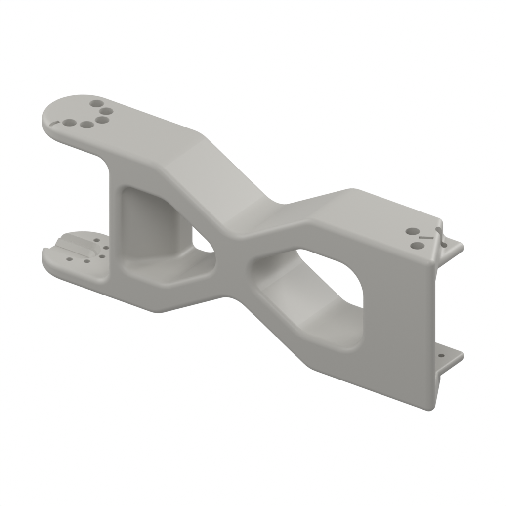</a> | 源名称：`关节3` CAD 包围尺寸：170.96 × 30.31 × 61.65 mm。 材质与制造工艺待确认。 | 1 |
| 6 | 关节 4 结构件 | [touch-r1-joint-4](step/parts/touch-r1-joint-4.step) | <a href="images/touch-r1-joint-4.png">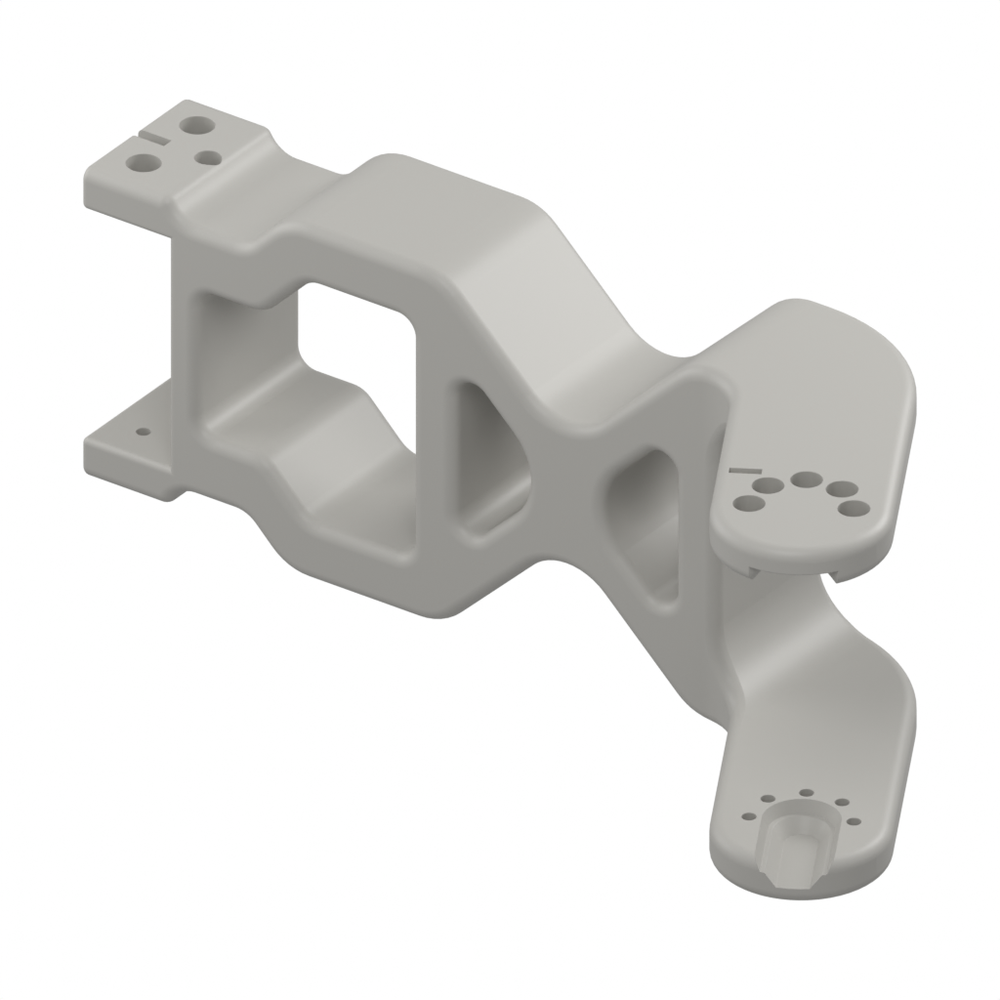</a> | 源名称：`关节4` CAD 包围尺寸：167.35 × 70.38 × 63.65 mm。 材质与制造工艺待确认。 | 1 |
| 7 | 关节 5 结构件 | [touch-r1-joint-5](step/parts/touch-r1-joint-5.step) | <a href="images/touch-r1-joint-5.png">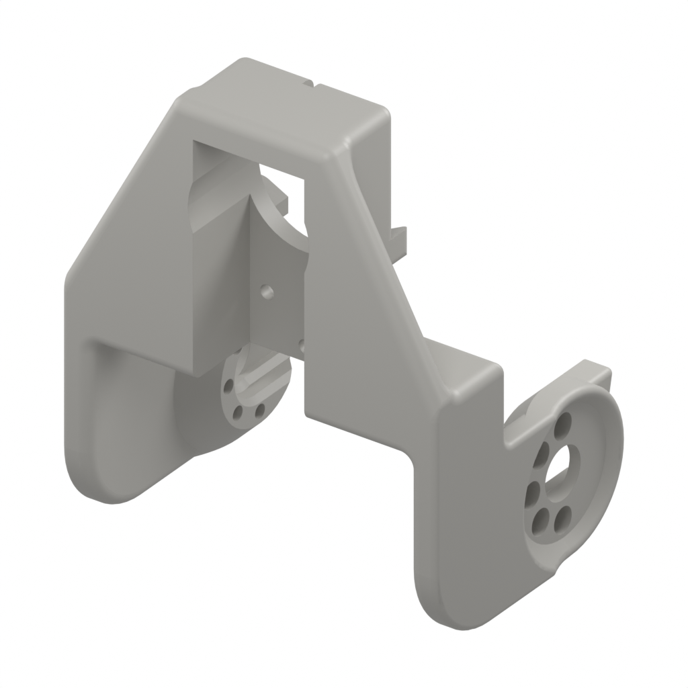</a> | 源名称：`关节5_NEW` CAD 包围尺寸：69.52 × 53.85 × 83.00 mm。 材质与制造工艺待确认。 | 1 |
| 8 | 关节 6 结构件 | [touch-r1-joint-6](step/parts/touch-r1-joint-6.step) |  | 源名称：`关节6_NEW` CAD 包围尺寸：46.20 × 25.75 × 51.70 mm。 材质与制造工艺待确认。 | 1 |
| 9 | 关节 7 手柄结构件 | [touch-r1-joint-7](step/parts/touch-r1-joint-7.step) |  | 源名称：`关节7` CAD 包围尺寸：65.25 × 135.66 × 51.22 mm。 CAD 中包含手柄外形；材质与制造工艺待确认。 | 1 |
| 10 | 垫片 | [touch-r1-spacer](step/parts/touch-r1-spacer.step) |  | 源名称：`垫片` CAD 包围尺寸：20.00 × 2.30 × 20.00 mm。 带孔垫片；材质与配合公差待确认。 | 1 |
| 11 | 支架 A000（用途待确认） | [touch-r1-part-a000](step/parts/touch-r1-part-a000.step) |  | 源名称：`A000` CAD 包围尺寸：41.12 × 41.76 × 8.00 mm。 保留源编号；用途、材质及工艺待确认。 | 1 |
| 12 | 支架 B000（用途待确认） | [touch-r1-part-b000](step/parts/touch-r1-part-b000.step) |  | 源名称：`B000` CAD 包围尺寸：10.00 × 22.11 × 13.51 mm。 保留源编号；用途、材质及工艺待确认。 | 1 |

规格写法参考 [Star Arm 102-HD 物料清单](https://github.com/servodevelop/Star-Arm-102/blob/main/hardware/102-hd/README.zh.md#bill-of-materials)。102 的 M3 × 10、M3 × 22、M2 × 8 等尺寸以及黑色表面、12.9 级等采购属性不自动适用于 R1；本表保留 R1 的实测尺寸和源实例数量。

## 采购补充件

下表列出装配实物所需的 **8 种标准五金件**，序号接着上表编排，可合成一张采购清单。第 13、14 行按实物确认的品名与规格列出（2026-10-20）；第 15–20 行品名与规格写法沿用 [102-FL 物料清单](https://github.com/servodevelop/Star-Arm-102/blob/main/hardware/102-fl/README.zh.md#bill-of-materials) 第 23、25、26、27、28、29 行的同款件，数量按 R1 的装配需求给定（2026-10-19）。

第 13、14 行的数据按型号给定；第 15–20 行的表面处理与强度等级取自 102 同款件的写法，与上一节同一原则，这些采购属性**不自动适用于 R1**，只是采购时的起点，使用前须按实物与采购渠道复核。本表手工维护，不由 `scripts/extract_step_bom.py` 生成。图片只用于识别类型：第 13、14 行沿用仓库已有的紧固件简图，第 15–20 行为 102 同款件的外观示意图（AI 生成）；规格以文字为准。

| 序号 | 品名 | 型号／规格 | 图片 | 描述 | 数量 |
| :---: | --- | --- | :---: | --- | :---: |
| 13 | 304 薄头内六角平尾自攻螺丝 | HB3 × 5 |  | 304 不锈钢；螺纹公称 Ø3，长度 5 mm；薄头内六角，平尾（钝头）自攻。 | 3 |
| 14 | 304 塞打螺丝（轴肩螺钉） | Ø2.5 × M2 × 3 |  | 304 不锈钢；轴肩 Ø2.5 × 3 mm，螺纹 M2。 | 2 |
| 15 | 内六角圆柱头螺钉 | M2 × 8 | <a href="images/fasteners/m2-8-socket-head-cap-screw.png">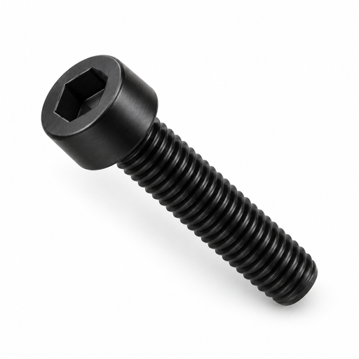</a> | 黑色表面 | 16 |
| 16 | 十字槽盘头自攻螺钉 | PB2.0 × 5 | <a href="images/fasteners/pb2-5-phillips-pan-head-self-tapping-screw.png">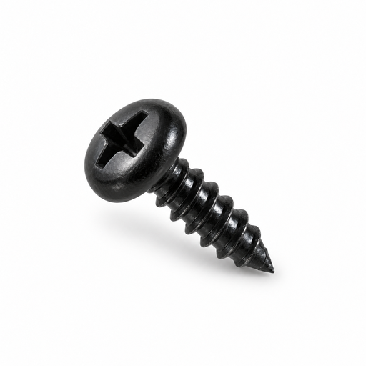</a> | 黑色表面，加硬 | 21 |
| 17 | 十字槽盘头螺钉 | M2 × 4.5 | <a href="images/fasteners/m2-4-5-phillips-pan-head-screw.png">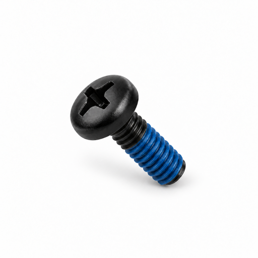</a> | 黑色表面；靠近末端的约 2/3 螺纹段预涂蓝色锁固胶 | 52 |
| 18 | 十字槽盘头螺钉 | M3 × 10 | <a href="images/fasteners/m3-10-phillips-pan-head-screw.png">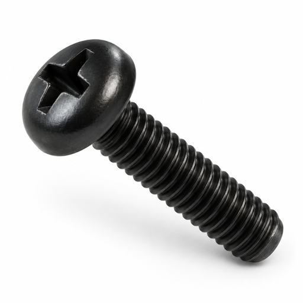</a> | 黑色表面，加硬 | 1 |
| 19 | 螺母 | M3 | <a href="images/fasteners/m3-nut.png">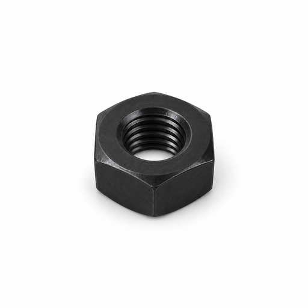</a> | 黑色表面 | 1 |
| 20 | 平垫圈 | M3（3 × 6 × 0.5 mm） | <a href="images/fasteners/m3-6-0-5-stainless-washer.png">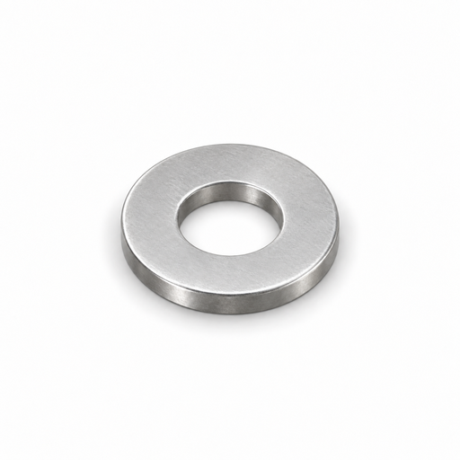</a> | 不锈钢 | 1 |

## 待确认事项

- 确认 `_25-50KG-0001_ASM_ASM` 的准确采购型号与交付内容。不能仅凭名称确定扭矩、电压、编码器或输出轴规格；标注为 RP8-U45H-M-C028 的子装配也需核对实际配置。
- 第 13 行 `HB3 × 5`（3 件）与第 14 行 `Ø2.5 × M2 × 3`（2 件）的品名、规格与材质按实物确认（2026-10-20）；螺纹精度、表面处理、用量与安装位置需按实物与采购渠道复核。
- 确认 A000、B000 的用途，以及全部结构件的材质、制造工艺和公差。不预设 PLA、打印参数或加工方式。
- 确认实物所需的完整紧固件、线缆、控制板、电源及配件。源装配树中只有 5 个顶层紧固件实例，不代表用 5 个紧固件就能完成装配。源名称中的关节 1–7 也不能据此认定机械臂的驱动自由度。
- [采购补充件](#purchase-parts)（第 13–20 行）为装配实物所需的五金件；第 13、14 行品名与规格按实物确认，第 15–20 行按 102 同款件写法记录，供应商、材质、表面处理与强度等级均需按 R1 实物与采购渠道复核。

## 装配与校准

装配顺序、经确认的紧固件规格、接线、关节限位及零位校准说明待补充。

现有 [Python 遥操作指南](../python-sdk/README.md) 面向 Star Arm 102 → Lumos；与此 V3.1 装配体的兼容性尚未验证。

## 验证状态

| 项目 | 状态 |
| --- | --- |
| V3.1 源装配体 | SHA-256 与附件一致；1 个根装配、21 个顶层实例 |
| V3.2 源装配体 | SHA-256 与附件一致；24 个顶层实例、115 个实体；用于七轴 URDF |
| V3.1 CAD 导入 | 99 个实体；通过 FreeCAD 形体有效性检查 |
| 16 份 STEP 导出件 | 已成功重新导入；实体数不变，最大相对体积差低于 0.0011%，包围尺寸差低于 0.001 mm |
| BOM 数量 | 已交叉核对 STEP 引用与导入对象；源映射保留于 bom.json |
| 标准件 | 第 13、14 行品名、规格与材质按实物确认（2026-10-20）；第 15–20 行规格沿用 102 同款件，待采购复核 |
| 零件简图 | 根据 CAD 网格渲染；使用中性显示材质；各图独立缩放 |
| 干涉、配合与实物装配 | 尚未验证 |
| 采购 BOM 完整性与硬件规格 | 待工程确认 |
| 采购补充件 | 数量按 R1 装配需求给定（2026-10-19）；规格参照 102 同款件，供应商与采购属性待确认 |
| URDF 与交互预览 | 已提供 9 连杆、7 控制关节及 1 从动关节的运动学草案；[查看预览说明](robot-description/) |
| 可打印性与动力学仿真 | 尚未验证；未提供打印文件、碰撞模型与惯量参数 |
| V3.1 的 Python 遥操作 | 尚未验证 |

几何检查用于验证 CAD 导入导出一致性，不代表通过制造验收。重新生成导出件和简图的方法见 [生成说明](../scripts/README.md)。
