# Touch R1 Leader Arm 硬件

[← 首页](../README.md)　|　**简体中文**

提供 V3.1／V3.2／V3.3 装配体 CAD 资源；物料清单、独立零件与 STL 网格导出件均基于 V3.3，七轴 URDF 仍基于 V3.2，V3.1、V3.2 装配体保留为历史版本。

**目录：**

- [⚙️ 产品规格](#specifications)
- [📂 资源目录](#resources)
- [📐 装配模型](#assembly-model)
- [📋 物料清单](#bill-of-materials)
- [🔎 待确认事项](#confirmation)
- [🛠️ 装配与校准](#assembly-and-calibration)
- [✅ 验证状态](#validation-status)

## 产品规格

| 规格 | Touch R1 Leader Arm |
| --- | --- |
| 硬件版本 | V3.3，依据所提供装配体的文件名标注；V3.1、V3.2 装配体保留为历史版本 |
| 产品类型 | 遥操作主臂 |
| 自由度 | 待确认 |
| 臂展与重量 | 待确认 |
| 电源与通信 | 待确认 |
| 执行器与编码器 | 待确认 |
| 关节运动范围 | 待确认 |

## 资源目录

| 目录／文件 | 内容 | 状态 |
| --- | --- | --- |
| [step/assembly/](step/assembly/) | 原始 V3.1／V3.2／V3.3 装配体 STEP | 源文件字节保持不变；已检查 CAD 导入（V3.3 为当前依据） |
| [step/components/](step/components/) | 用户提供的 RP8-U45H-M / C028 舵机 STEP | 用于 URDF 视觉模型，保留原文件内容 |
| [step/parts/](step/parts/) | 17 份独立零件或子装配 STEP | 已通过导出与重新导入检查 |
| [bom.json](bom.json) | BOM 数量、源编号、实例位置及几何检查结果 | 根据源装配树提取 |
| [printing/stl/](printing/stl/) | 11 份结构件 STL 网格：Link 1–6、手柄装配、左右手指、A000、底座 | 由 V3.3 实体三角化；边界边为 0，网格闭合 |
| [printing/3mf/](printing/3mf/) | 独立零件与整套打印项目 | 待补充 |
| [drawings/](drawings/) | 带尺寸工程图纸，PDF／DWG | 待补充 |
| [robot-description/](robot-description/) | V3.2 七轴 URDF、网格和交互预览 | 包含 J7 舵机与双 finger，排除两个限位块；尚未跟进 V3.3，实机参数待确认 |

## 装配模型

- [下载 V3.3 装配体 STEP](step/assembly/touch-r1-leader-arm-v3.3-1023.stp)：**当前 BOM、独立零件与 STL 导出件的依据**。相对 V3.2 加装 `0002` 底座、去掉 `B000` 支架，并改动了 Link 1–5、手柄装配与三颗自攻螺丝。
- [下载 V3.2 装配体 STEP](step/assembly/touch-r1-leader-arm-v3.2-1013.stp)：上一版，同时是当前七轴 URDF 的依据。
- [下载 V3.1 装配体 STEP](step/assembly/touch-leader-arm-v3.1-1013.stp)：历史版本，保留供对照；其 BOM 与导出件已被后续版本取代。

V3.3 原文件 `遥操臂V3.3_1023.stp` 仅规范保存名称，文件内容保持不变，共 115 个实体，含 A000 与 `0002` 底座，不含 V3.2 的 B000。V3.2 原文件 `遥操臂V3.2_1013(1).stp` 同样原样保存；URDF 专用快照排除 A000、B000 两个限位块，[来源记录](robot-description/source/assembly-source.json) 保存该原文件 SHA-256。

所提供的文件 `遥操臂V3.1_1013.stp` 以 `touch-leader-arm-v3.1-1013.stp` 保存，内容未作修改。STEP 文件头记录的导出软件为 Creo Parametric，导出时间为 `2026-10-13T11:21:50`。版本标注来自源文件名。

独立 STEP 保留各组件自身的 CAD 坐标系；舵机导出件保留内部几何，作为完整子装配提供。这些文件为参考 CAD 导出件，尚未指定制造或打印工艺。

[printing/stl/](printing/stl/) 下的 11 份 STL 由同一批 V3.3 实体以 0.05 mm 线性偏差、0.3 rad 角度偏差三角化成二进制 STL，坐标系与对应的 STEP 导出件一致，逐件检查边界边为 0（网格闭合）。它们用于切片前的形状检查，打印参数、支撑与材料未定。

## 物料清单

下表列出一套装配体的完整物料，共 **29 项**：结构件、底座与舵机 13 项（装配体中 18 个顶层实例），标准件与配件 16 项。装配体另有 5 个紧固件实例并入第 14–16 行，1 个经确认不存在的「垫片」实体未列入，合计 24 个顶层实例。

结构件与舵机的数量来自 STEP 装配引用，逐项记录在 `bom.json`；标准件与配件为采购件，规格按 102 同款件与实物确认记录，数量按 R1 装配需求给定。装配体中的 5 个紧固件实例（自攻螺丝 3 件、塞打螺丝 1 件、`PRT0007` 1 件）已按采购规格并入本表，不再单列。

装配体中另有一个源名称为「垫片」（`_X2_57AB7247_X0_`）的实体，经确认不是实际使用的零件，**未列入本表**；其 CAD 记录仍保留在 `bom.json`。

表内品名与描述沿用 Star Arm 102 的英文写法（`No. | Part Name | Model / Specification | Image | Description | Quantity`），不再逐条译成中文。结构件的图片由源 STEP 几何渲染为 1024 × 1024 白底图；舵机为产品外观图，标准件与配件为产品外观图或示意图。所有图片只用于识别类型，不代表实物材质、颜色或表面处理，各图独立缩放。表内 CAD 包围尺寸为零件本地坐标轴的包围盒尺寸，四舍五入到 0.01 mm，不是工程尺寸、公差或采购规格。

| No. | Part Name | Model / Specification | Image | Description | Quantity |
| :---: | --- | --- | :---: | --- | :---: |
| 1 | UART bus servo | [RP8-U45H-M-C028](step/parts/touch-r1-servo-rp8-u45h-m-c028.step) | <a href="images/parts/rp8-u45h-m-c028.webp">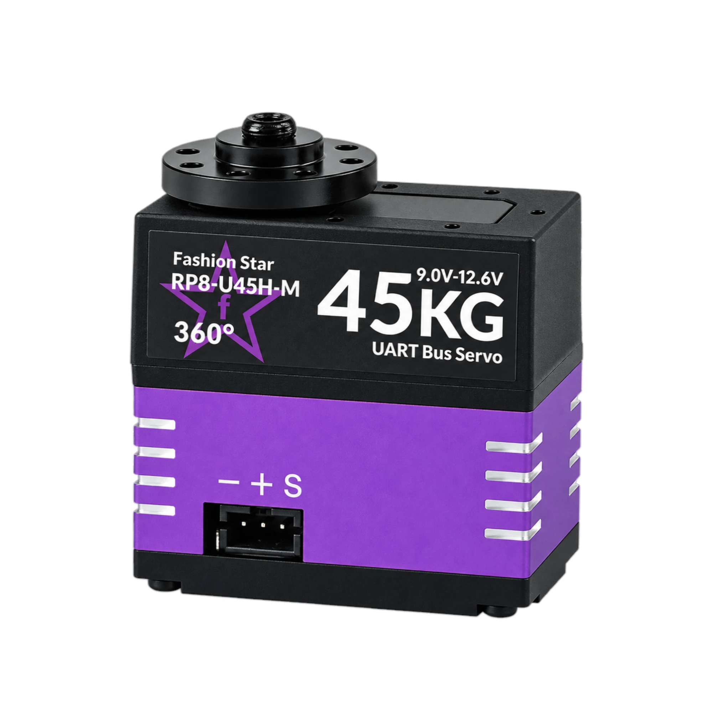</a> | 12V; 45kg-cm; 118rpm; Dual-shaft Housing (Flat Bottom Cover, No Rear Output Shaft); Coreless Motor; 12-bit Magnetic Absolute Encoder; 25T | 4 |
| 2 | UART bus servo | [RP8-U45H-M](step/parts/touch-r1-servo-25-50kg-0001.step) | <a href="images/parts/rp8-u45h-m.webp">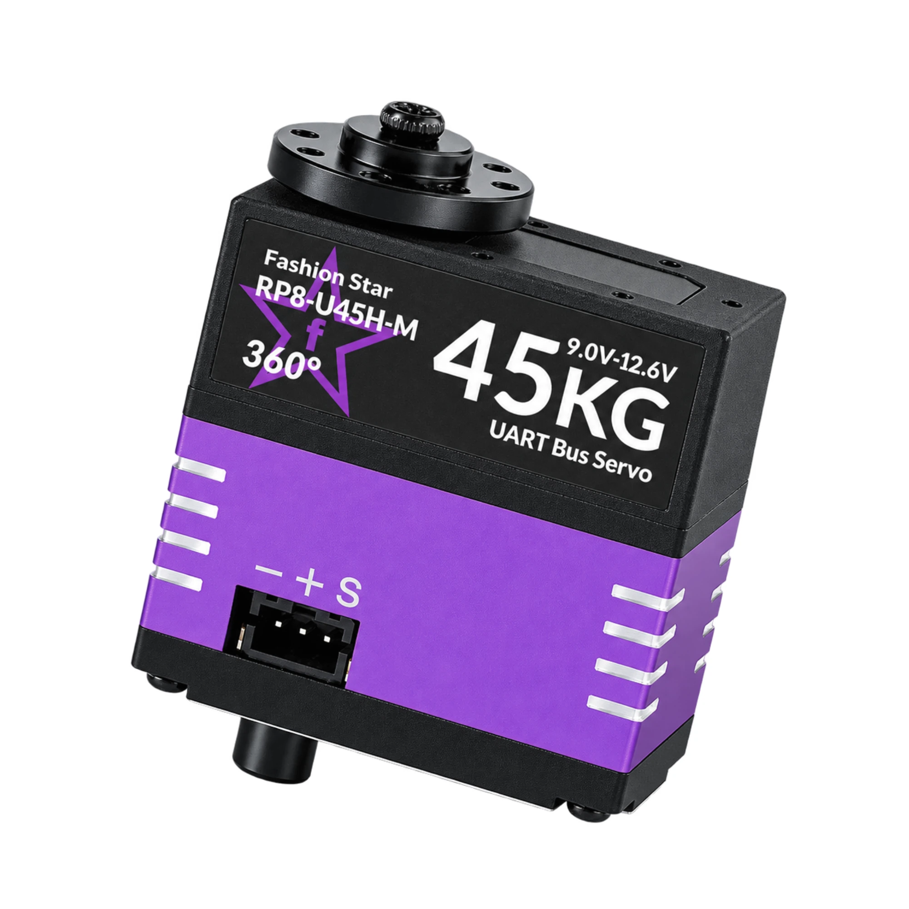</a> | 12V; 45kg-cm; 118rpm; Dual-shaft; Coreless Motor; 12-bit Magnetic Absolute Encoder; 25T | 3 |
| 3 | Link 1 | [touch-r1-joint-1](step/parts/touch-r1-joint-1.step) |  | Source name: `_X2_51738282_X0_1_NEW` CAD bounding box: 120.03 × 56.00 × 120.02 mm. Material and manufacturing process TBD. | 1 |
| 4 | Link 2 | [touch-r1-joint-2](step/parts/touch-r1-joint-2.step) |  | Source name: `_X2_51738282_X0_2__X2_65B0_X0_` CAD bounding box: 69.27 × 25.68 × 46.15 mm. Material and manufacturing process TBD. | 1 |
| 5 | Link 3 | [touch-r1-joint-3](step/parts/touch-r1-joint-3.step) |  | Source name: `_X2_51738282_X0_3` CAD bounding box: 170.96 × 30.31 × 61.65 mm. Material and manufacturing process TBD. | 1 |
| 6 | Link 4 | [touch-r1-joint-4](step/parts/touch-r1-joint-4.step) |  | Source name: `_X2_51738282_X0_4` CAD bounding box: 167.51 × 70.38 × 63.65 mm. Material and manufacturing process TBD. | 1 |
| 7 | Link 5 | [touch-r1-joint-5](step/parts/touch-r1-joint-5.step) |  | Source name: `_X2_51738282_X0_5_NEW` CAD bounding box: 69.52 × 53.85 × 83.00 mm. Material and manufacturing process TBD. | 1 |
| 8 | Link 6 | [touch-r1-joint-6](step/parts/touch-r1-joint-6.step) |  | Source name: `_X2_51738282_X0_6_NEW` CAD bounding box: 46.20 × 25.75 × 51.70 mm. Material and manufacturing process TBD. | 1 |
| 9 | Handle assembly | [touch-r1-handle-assembly](step/parts/touch-r1-handle-assembly.step) | <a href="images/touch-r1-handle-assembly.png">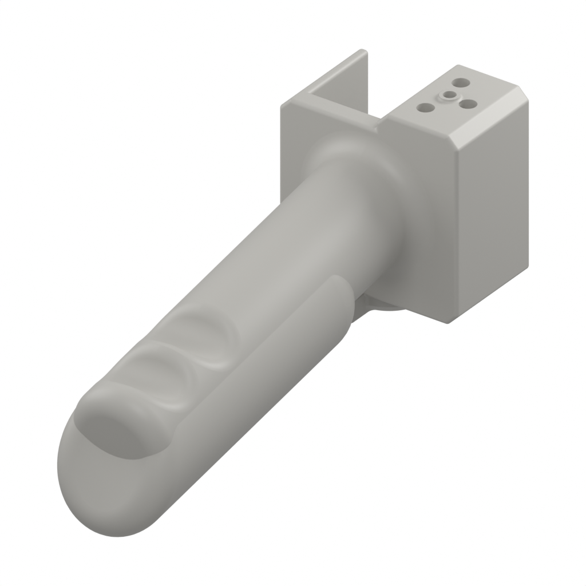</a> | Source name: `SHOUBING_ASM` CAD bounding box: 50.40 × 138.32 × 65.07 mm. Handle sub-assembly with internal CAD parts. | 1 |
| 10 | Left finger | [touch-r1-finger-left](step/parts/touch-r1-finger-left.step) | <a href="images/touch-r1-finger-left.png">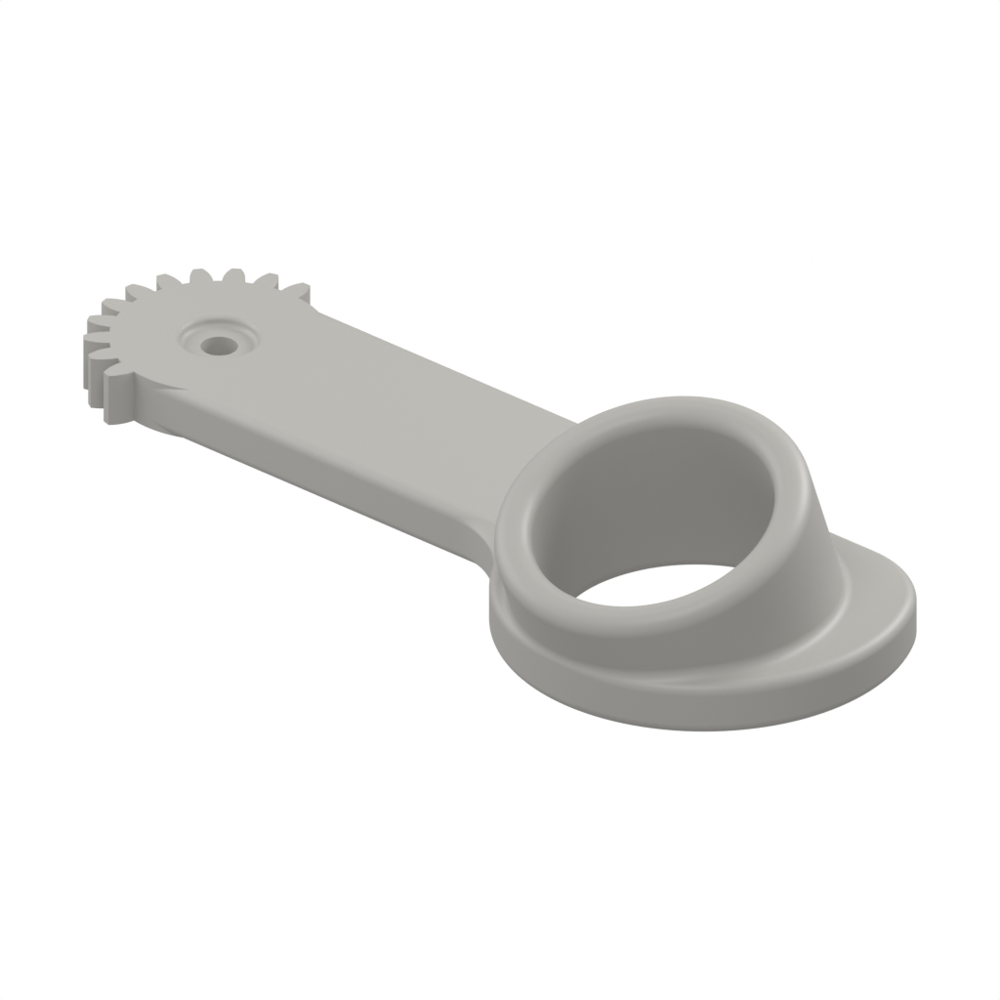</a> | Source name: `LEFT_ZHUA` CAD bounding box: 92.13 × 42.99 × 26.55 mm. Driven in reverse from the right finger via URDF `mimic`. | 1 |
| 11 | Right finger | [touch-r1-finger-right](step/parts/touch-r1-finger-right.step) | <a href="images/touch-r1-finger-right.png">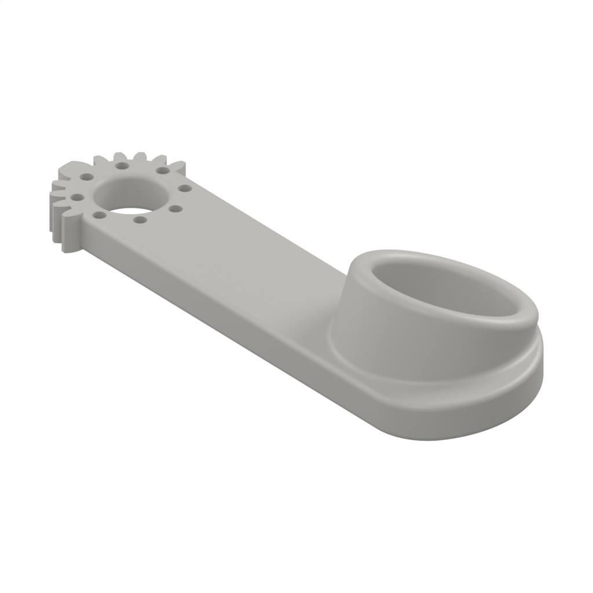</a> | Source name: `RIGHT_ZHUA` CAD bounding box: 92.62 × 40.27 × 24.74 mm. Driven directly by the J7 servo. | 1 |
| 12 | Bracket A000 (purpose TBD) | [touch-r1-part-a000](step/parts/touch-r1-part-a000.step) |  | Source name: `A000` CAD bounding box: 41.12 × 41.76 × 8.00 mm. Source ID retained; purpose, material and process TBD. | 1 |
| 13 | Base plate | [touch-r1-base-plate](step/parts/touch-r1-base-plate.step) | <a href="images/touch-r1-base-plate.png">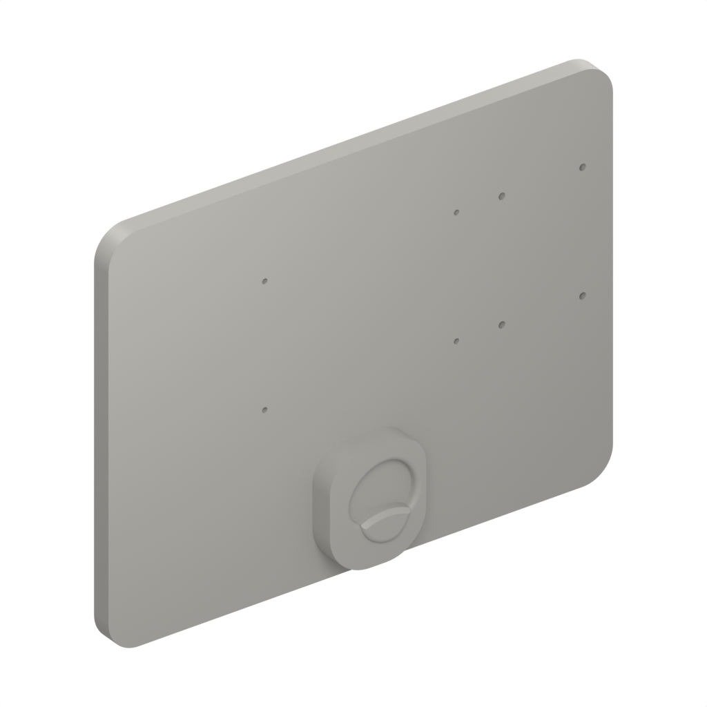</a> | Source name: `0002` CAD bounding box: 250.00 × 24.17 × 194.00 mm. Replaces the V3.2 `B000` bracket; Ø40 / Ø30 bearing seat and 6 mounting holes. Purpose, material and manufacturing process TBD. | 1 |
| 14 | 304 thin-head hex-socket blunt-tip self-tapping screw | HB3 × 5 | <a href="images/touch-r1-fastener-gb-t70-1-m3x530001.png">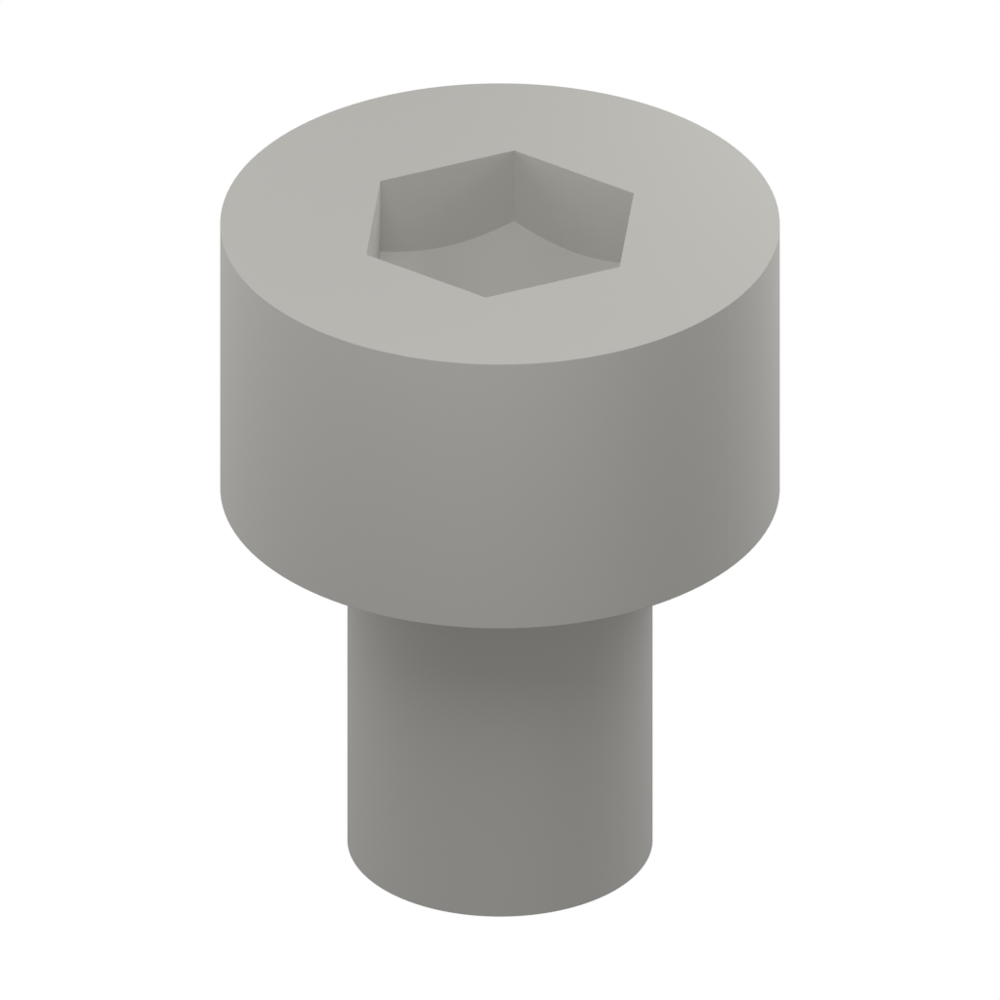</a> | 304 stainless steel; nominal thread Ø3, length 5 mm; thin-head hex socket, blunt tip. CAD: head Ø5.50 × 3.00 mm, under-head length 4.00 mm (head was 2.00 mm thick in V3.2). All three instances share the source part `GB_T70_1-M3X530001`. | 3 |
| 15 | 304 shoulder screw | Ø2.5 × M2 × 3 |  | 304 stainless steel; shoulder Ø2.5 × 3 mm, thread M2. | 1 |
| 16 | Socket-head cap screw | M3 × 10 | <a href="images/touch-r1-fastener-prt0007.png">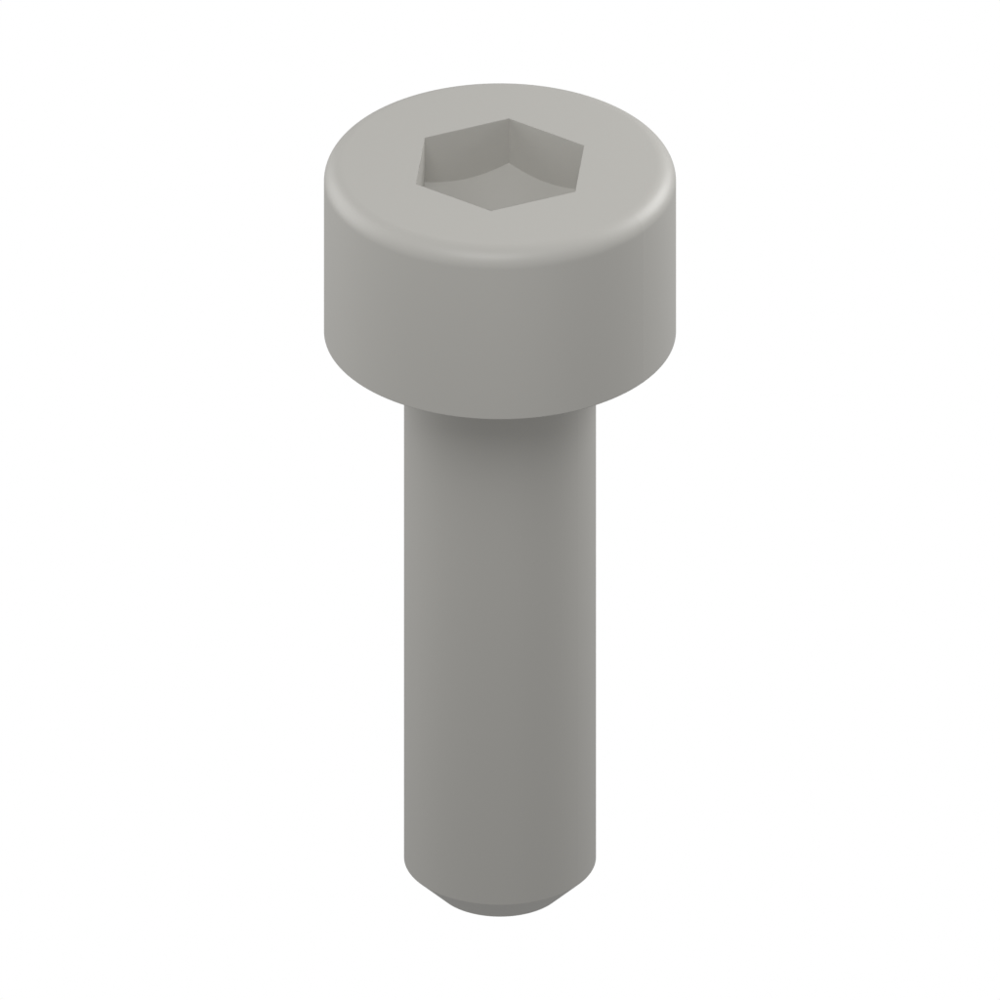</a> | Source name: `PRT0007`; new in V3.3. Confirmed as an M3 × 10 socket-head cap screw (2026-10-23). CAD: hex-socket head Ø5.50 × 2.70 mm, shank Ø3.00 mm, under-head length 9.50 mm. Material and finish TBD. | 1 |
| 17 | Socket-head cap screw | M2 × 8 |  | Black finish | 16 |
| 18 | Phillips pan-head self-tapping screw | PB2.0 × 5 |  | Black finish, hardened | 28 |
| 19 | Phillips pan-head screw | M2 × 4.5 |  | Black finish; blue pre-applied threadlocker on approximately the lower two-thirds of the threaded shank (toward the tip) | 52 |
| 20 | Phillips pan-head screw | M3 × 10 |  | Black finish, hardened | 1 |
| 21 | Nut | M3 |  | Black finish | 1 |
| 22 | Washer | M3 (3 × 6 × 0.5 mm) |  | Stainless steel | 1 |
| 23 | HD button cover | hd-button-cover | <a href="images/parts/hd-button-cover.png">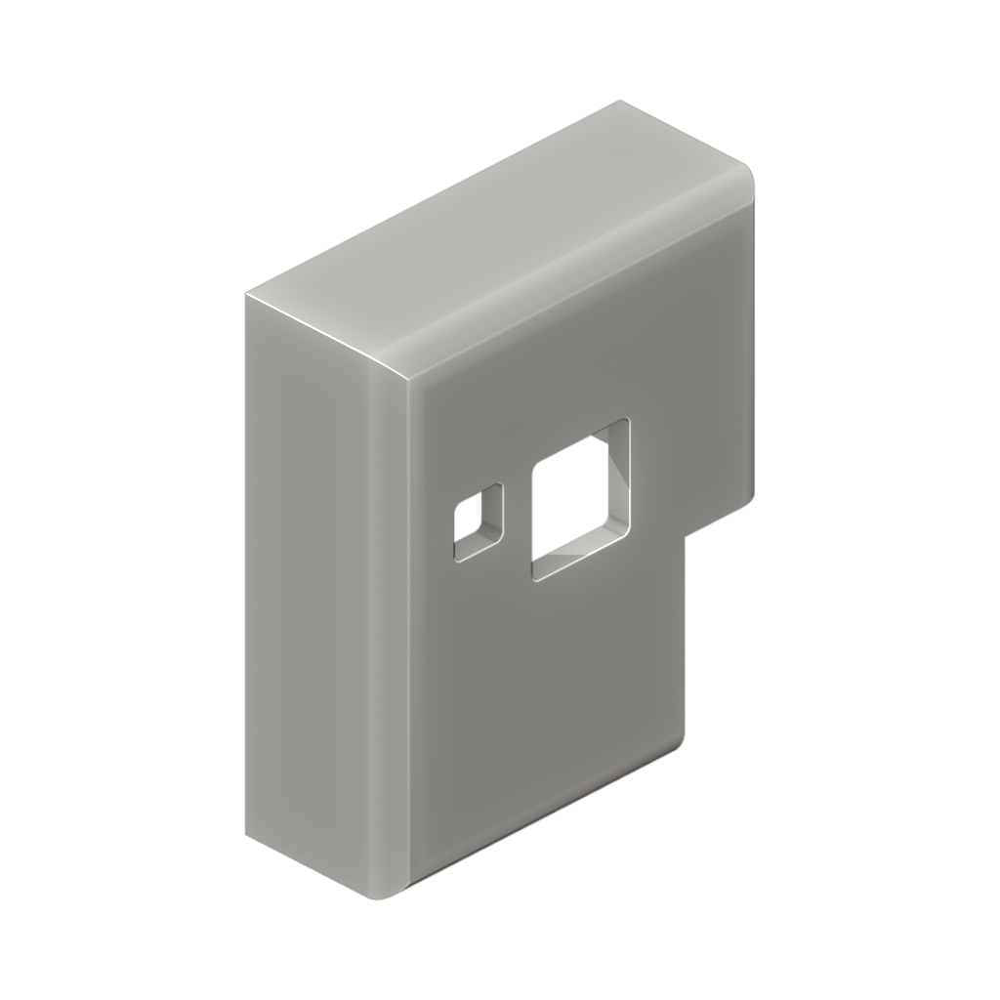</a> | Ivory, PLA 3D printed part | 1 |
| 24 | HD button base | hd-button-base | <a href="images/parts/hd-button-base.png">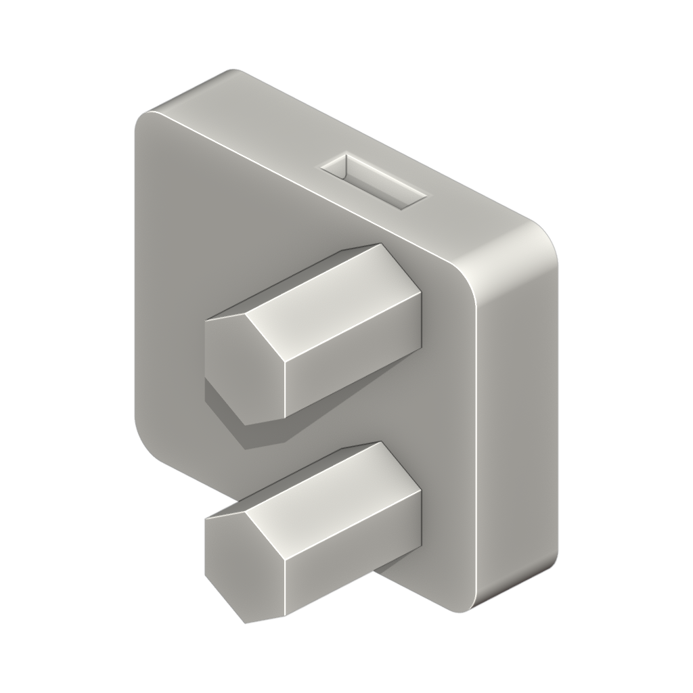</a> | Ivory, PLA 3D printed part | 1 |
| 25 | TTL/USB Servo Adapter | UC-01 |  | USB Type-C; half-/full-duplex conversion; selectable 3.3 V / 5 V TTL levels; 6–15 V input; 2 × PH2.0 servo ports; reverse-polarity protection; XT30 connector | 1 |
| 26 | Button board | UK-01 |  | With socket | 1 |
| 27 | Thrust needle roller bearing | AXK2035+2AS | <a href="images/parts/axk2035-2as-bearing.png">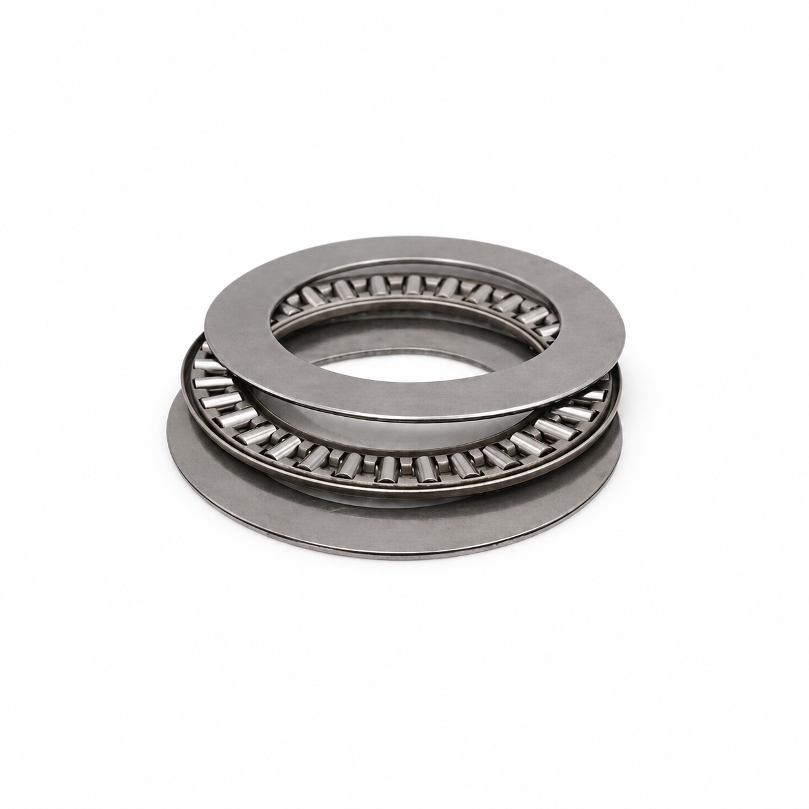</a> | Inner diameter 20 mm, outer diameter 35 mm, thickness 4 mm | 1 |
| 28 | Servo cable | PH2.0 (PH-3Y) 120 mm | <a href="images/parts/ph3y-servo-cable-120mm.png">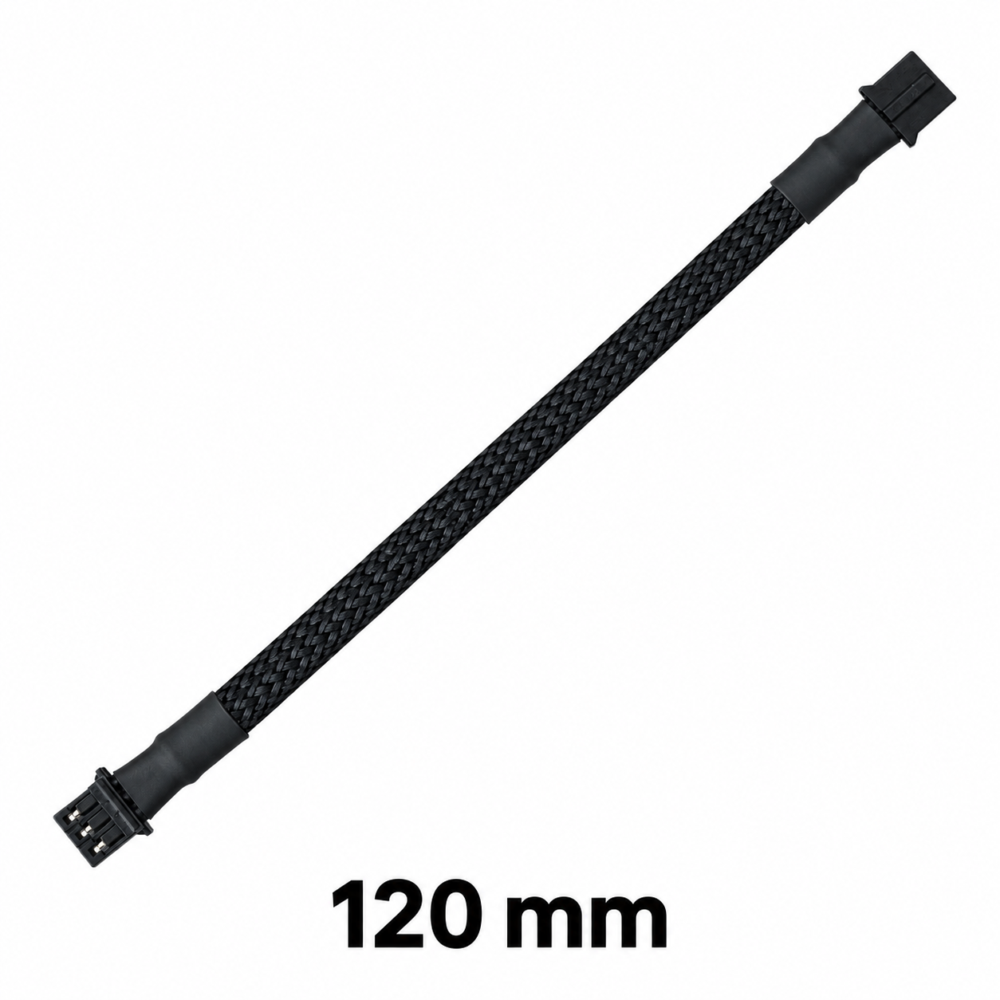</a> | Black silicone-insulated ribbon cable with black braided sleeving; reversed pin order between ends; 60 × Ø0.08 mm strands per conductor (approx. 22 AWG) | 3 |
| 29 | Servo cable | PH2.0 (PH-3Y) 200 mm |  | Black silicone-insulated ribbon cable with black braided sleeving; reversed pin order between ends; 60 × Ø0.08 mm strands per conductor (approx. 22 AWG) | 5 |

## 待确认事项

- 源名称为 `_25-50KG-0001_ASM_ASM` 的子装配（3 件）按实物确认为 **RP8-U45H-M**；源名称未体现型号，交付配置（舵盘、线材、固件）仍需核对。`RP8-U45H-M-C028`（4 件）同样需核对实际配置。
- 第 14 行 `HB3 × 5`（3 件）与第 15 行 `Ø2.5 × M2 × 3`（1 件）的品名、规格与材质按实物确认（2026-10-20）；螺纹精度、表面处理、用量与安装位置需按实物与采购渠道复核。**V3.3 的 CAD 把自攻螺丝头厚由 2.00 mm 加厚到 3.00 mm**，实物是否同步加厚、加厚后是否仍是「薄头」待确认。
- 第 16 行 `PRT0007`（1 件）是 V3.3 新增的紧固件，源名称未沿用既有紧固件命名，按实物确认为 **M3 × 10 内六角圆柱头螺钉**（2026-10-23）；材质、强度等级与表面处理待确认。CAD 实测头 Ø5.50 × 2.70 mm、杆 Ø3.00 mm、头下长度 9.50 mm，比标称 10 mm 少 0.5 mm，差值来自螺纹收尾与头部倒角的建模方式。
- 源名称为「垫片」的实体（`_X2_57AB7247_X0_`，CAD 包围 20.00 × 2.30 × 20.00 mm）经确认不是实际使用的零件，已从物料清单剔除；`bom.json` 仍保留其 CAD 记录，`step/parts/touch-r1-spacer.step` 保留供核对。
- 确认 A000、`0002` 底座的用途，以及全部结构件的材质、制造工艺和公差。不预设 PLA、打印参数或加工方式。底座带 Ø40／Ø30 轴承座，与第 27 行的 AXK2035 推力滚针轴承是否配套待确认。
- 确认实物所需的完整紧固件、线缆、控制板、电源及配件。源装配树中只有 5 个顶层紧固件实例，不代表用 5 个紧固件就能完成装配。源名称中的关节 1–6 也不能据此认定机械臂的驱动自由度。
- V3.2 相对 V3.1 的变化（按装配体实测）：关节 7 由「手柄装配」取代，新增左右手指，RP8 舵机子装配由 3 个增至 4 个（多出的是 J7 手指驱动舵机），原台阶螺钉的源名称改为 M2X4X30001（几何 69.45 mm³ 不变）；其余 13 种结构件与舵机几何未变。
- V3.3 相对 V3.2 的变化（按装配体实测）：新增 `0002` 底座（508.88 cm³，250.00 × 24.17 × 194.00 mm）；删除 `B000` 支架，由底座取代；三颗自攻螺丝由 `PRT0001`／`PRT0002`／`GB_T70_1-M3X400` 三个源件合并为 `GB_T70_1-M3X530001` 一个源件，头厚 2.00 → 3.00 mm；塞打螺丝由 2 件减为 1 件；新增紧固件 `PRT0007` 1 件；Link 1–5 与手柄装配有几何修改（Link 4 +1559.77 mm³、Link 5 +345.29 mm³、Link 1 −555.43 mm³、Link 3 −52.70 mm³、Link 2 +21.23 mm³、手柄 −47.99 mm³），其余结构件体积不变。请确认这些变化是设计意图。
- 手指联动关系取自 URDF（右手指直驱、左手指通过 mimic 反向联动），机械限位、零位与夹持力需按实物确认。
- 第 17–22 行的紧固件规格、表面处理与强度等级沿用 102 同款件写法；第 23–29 行的按钮盖／按钮座、UC-01、UK-01、推力滚针轴承与舵机连接线按 102 同型件记录。以上供应商、材质与实配数量均需按 R1 实物与采购渠道复核。

## 装配与校准

装配顺序、经确认的紧固件规格、接线、关节限位及零位校准说明待补充。

现有 [Python 遥操作指南](../python-sdk/README.md) 面向 Star Arm 102 → Lumos；与此 V3.3 装配体的兼容性尚未验证。

## 验证状态

| 项目 | 状态 |
| --- | --- |
| V3.1 源装配体 | SHA-256 与附件一致；1 个根装配、21 个顶层实例 |
| V3.2 源装配体 | SHA-256 与附件一致（2654e3b…）；24 个顶层实例、115 个实体；现为上一版，仍是七轴 URDF 的依据 |
| V3.3 源装配体 | SHA-256 与附件一致（7f96310c…）；24 个顶层实例、115 个实体；BOM、STEP 与 STL 导出件的依据 |
| V3.1 CAD 导入（历史） | 99 个实体；通过 FreeCAD 形体有效性检查 |
| V3.3 CAD 导入 | 115 个实体；通过 FreeCAD 形体有效性检查 |
| 17 份 STEP 导出件 | 已成功重新导入；实体数不变，最大相对体积差低于 0.0011%，包围尺寸差低于 0.001 mm |
| 11 份 STL 网格 | 二进制 STL，线性偏差 0.05 mm／角度 0.3 rad；边界边 0 条，网格闭合 |
| BOM 数量 | 已交叉核对 STEP 引用与导入对象；源映射保留于 bom.json |
| 标准件与配件 | 第 14、15 行品名、规格与材质按实物确认（2026-10-20）；第 16 行 `PRT0007` 按实物确认 M3 × 10（2026-10-23），材质与表面处理待确认；第 17–29 行规格沿用 102 同型件，数量按 R1 装配需求给定，待采购复核 |
| 零件简图 | 根据 CAD 网格渲染；使用中性显示材质；各图独立缩放 |
| 干涉、配合与实物装配 | 尚未验证 |
| 采购 BOM 完整性与硬件规格 | 待工程确认 |
| URDF 与交互预览 | 已提供 9 连杆、7 控制关节及 1 从动关节的运动学草案，仍基于 V3.2 几何；[查看预览说明](robot-description/) |
| 可打印性与动力学仿真 | 尚未验证；未提供打印参数、碰撞模型与惯量参数 |
| V3.1 的 Python 遥操作 | 尚未验证 |

几何检查用于验证 CAD 导入导出一致性，不代表通过制造验收。重新生成导出件和简图的方法见 [生成说明](../scripts/README.md)。
