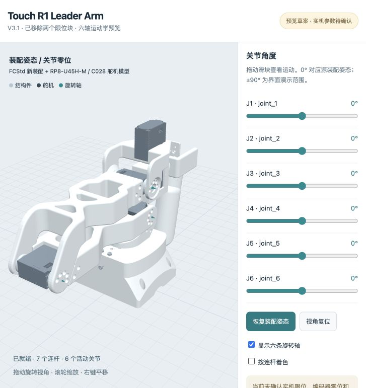
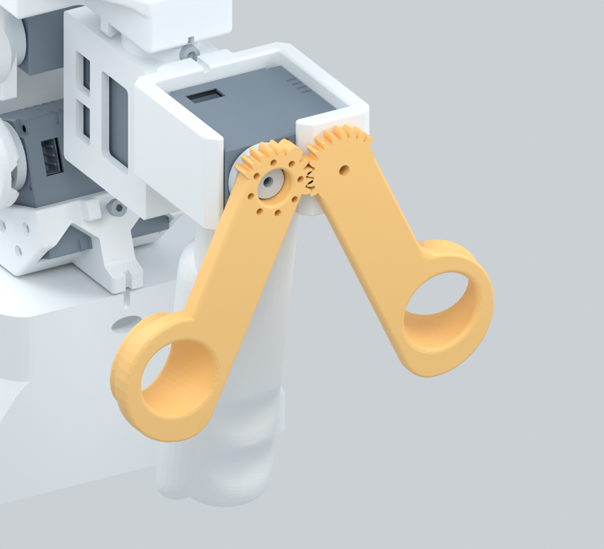

# Touch R1 Leader Arm 机器人描述

[← Touch R1 Leader Arm 硬件](../README.md)　|　<sub>**简体中文**</sub>

基于 **V3.2 装配体**生成七轴运动学预览：包含七个舵机、手柄和左右两个 finger。J1–J6 控制机械臂，J7 控制 finger 开合；左 finger 按 CAD 齿形推定为 1:1 反向从动。

**目录：**

- [📦 下载与预览](#preview)
- [🔩 模型来源](#sources)
- [🔄 关节与坐标](#kinematics)
- [⚠️ 待确认参数](#confirmation)
- [✅ 验证与重新生成](#validation)

<a id="preview"></a>

## 下载与预览

| 资源 | 用途 |
| --- | --- |
| [完整资源包 ZIP](touch-r1-urdf.zip) | URDF、25 份网格、交互预览与使用说明；下载后解压 |
| [touch-r1.urdf](touch_r1_description/urdf/touch-r1.urdf) | 9 个连杆、7 个独立控制关节和 1 个从动关节；需配套网格 |
| [交互预览页面](preview/index.html) | 七个滑块、双 finger 联动、旋转视角、姿态复位、按连杆着色 |
| [生成与轴线记录](kinematics.json) | 源文件校验、转轴测量、实体归属与网格信息 |



GitHub 只展示 HTML 源码，不直接运行交互预览。在仓库根目录执行：

```bash
cd hardware/robot-description
python -m http.server 8765 --bind 127.0.0.1
```

打开 `http://127.0.0.1:8765/preview/`。下载 ZIP 时，在解压目录执行同一条服务器命令；端口被占用可改为 `8766`。预览依赖已随包提供，无需联网。

拖动模型旋转视角，滚轮缩放，右键平移。J7 滑块同时驱动左右 finger；左 finger 不另设独立滑块。0° 恢复源装配姿态；J1–J6 的 ±90° 和 J7 的 0–25° 均只是演示范围，不是实机限位。更新资源后刷新页面；URDF、元数据与网格按当前版本加载。

<a id="sources"></a>

## 模型来源

| 来源 | 使用方式 |
| --- | --- |
| [V3.2 原始 STEP](../step/assembly/touch-r1-leader-arm-v3.2-1013.stp) | 本次装配几何与安装位置依据；原文件名为 `遥操臂V3.2_1013(1).stp`，保存内容与附件完全一致 |
| [URDF 专用 FCStd 快照](source/r1-hd-urdf-only.FCStd) | 从 V3.2 STEP 导入，排除 A000、B000 两个限位块；沿用已有文件名以保持链接可用 |
| [来源及排除记录](source/assembly-source.json) | 原 STEP 名称、SHA-256、源实体数、排除对象及 FCStd 校验值 |
| [RP8-U45H-M-C028](../step/components/rp8-u45h-m-c028.step) | 替换 4 个 C028 舵机实例，包含新增 J7 舵机 |
| [RP8-U45H-M](../step/components/rp8-u45h-m.step) | 替换 3 个双出轴舵机实例 |

V3.2 STEP 共 **115 个实体**。排除两个限位块后，**113 个源实体**全部唯一归属；三个双出轴舵机替换时各增加一个内部实体，因此输出视觉模型共 **116 个实体**。

此次新增的关键对象是第七个 C028 舵机、`LEFT_ZHUA`、`RIGHT_ZHUA`，手柄采用 V3.2 的 `SHOUBING_ASM`。生成器遍历实体叶节点，避免把父装配缓存重复计入。舵机替换前后的轴线及包围尺寸均检查，最大包围边界差约 0.00043 mm。

[硬件 CAD BOM](../README.md#bill-of-materials) 仍基于 V3.1，未随本次 URDF 更新改写采购清单。显示颜色用于区分零件，不代表实物材质或颜色。

<a id="kinematics"></a>

## 关节与坐标

URDF 使用米和弧度。源 CAD 为毫米，绕 X 轴旋转 +90°，将 Y 向上转为 Z 向上，再平移至基座底面 Z=0。0° 为源装配姿态，**不代表编码器零位**。

| 关节 | 上游 → 下游 | 零位轴向 | 功能 |
| --- | --- | --- | --- |
| J1 | base_link → link_1 | +Z | 机械臂第 1 轴 |
| J2 | link_1 → link_2 | +X | 机械臂第 2 轴 |
| J3 | link_2 → link_3 | +X | 机械臂第 3 轴 |
| J4 | link_3 → link_4 | +X | 机械臂第 4 轴 |
| J5 | link_4 → link_5 | +Z | 机械臂第 5 轴 |
| J6 | link_5 → link_6 | −Y | 手柄及整个 finger 机构 |
| J7 | link_6 → right_finger | −Y | 第七个舵机驱动右 finger |
| 左 finger 从动轴 | link_6 → left_finger | −Y | `mimic joint_7`，倍率 −1，偏置 0 |

J7 机壳跟随手柄 `link_6`，舵盘跟随 `right_finger`。两侧 finger 是手柄上的两个分支，不把左 finger 串接在右 finger 后面。

右 finger 与 J7 输出轴同轴；左 finger 的 1.65 mm 孔与手柄的 1.6 mm 孔同轴。两轴平行，中心距 **22 mm**；两侧同轴齿根／齿顶圆半径均为 **9.75 / 12 mm**。据此采用 1:1 反向联动的运动学推定，实际传动关系与行程仍需实物复核。预览读取 URDF 的 `mimic`，不另设一套联动参数。



<a id="confirmation"></a>

## 待确认参数

- **限位**：使用 `continuous` 供可视化，不表示实机能无限旋转。界面范围不是实际行程，取得实测值后应改用 `revolute` 并补充参数。
- **零位与方向**：编码器零位、正方向、舵机 ID 与关节对应关系待校准。
- **Finger 联动**：1:1 反向传动为 CAD 推定；啮合、间隙和极限开合尚未做实物或碰撞验收。
- **附件归属**：保留源文件中的垫片和五个紧固件，固定归属仍需实物复核。
- **动力学与控制**：没有质量、惯量、力矩、速度、碰撞网格、驱动或控制接口；不能作为已标定的实机控制模型。
- **软件集成**：通用 URDF 与网格目录，未制作 ROS 启动包，未在 RViz／Gazebo 上运行验收。导入时需保留相对资源路径并支持 `mimic`。

<a id="validation"></a>

## 验证与重新生成

| 检查 | 结果 |
| --- | --- |
| 连接树 | 单根 base_link，9 个连杆、7 个独立控制关节和 1 个从动关节 |
| 实体覆盖 | 113 个保留源实体唯一归属；包含七个舵机和左右 finger；无 A000／B000 |
| 网格 | 25 个二进制 STL，214,230 个三角面；引用、单位、校验值及旧网格残留检查通过 |
| 零位包围尺寸 | 约 105 × 304.860 × 191.514 mm，基座底面 Z≈0 |
| 轴线 | 舵机轴与下游结构、左 finger 与手柄安装孔交叉核对 |
| 独立解析与联动 | URDF 独立解析、J7 及从动关系、零位及开合姿态检查 |
| 视觉检查 | 从交付 URDF 渲染装配姿态与 J7 开合姿态；本轮浏览器界面未自动验收 |
| 实机与动力学 | 尚未验证 |

用已保存的 FCStd 快照重新生成：

```bash
PYTHONPATH=/Applications/FreeCAD.app/Contents/Resources/lib \
  /Applications/FreeCAD.app/Contents/Resources/bin/python scripts/generate_urdf.py
python scripts/check_urdf.py
python scripts/package_urdf.py
```

如需从本次原始 STEP 重建快照，先运行下列命令，再执行上述生成步骤。命令使用仓库内的 V3.2 源文件；源 STEP 校验值不一致时会中止，需先审核零件映射。

```bash
PYTHONPATH=/Applications/FreeCAD.app/Contents/Resources/lib \
  /Applications/FreeCAD.app/Contents/Resources/bin/python \
  scripts/import_urdf_source.py hardware/step/assembly/touch-r1-leader-arm-v3.2-1013.stp
```

生成使用 FreeCAD 1.1.4；网格线性离散 0.12 mm、角度离散 0.35 rad，均为显示参数而非制造公差。预览使用 Three.js 0.180.0，附带 [MIT 许可](preview/THREE-LICENSE.txt)；脚本及渲染方法见 [维护说明](../../scripts/README.md)。
